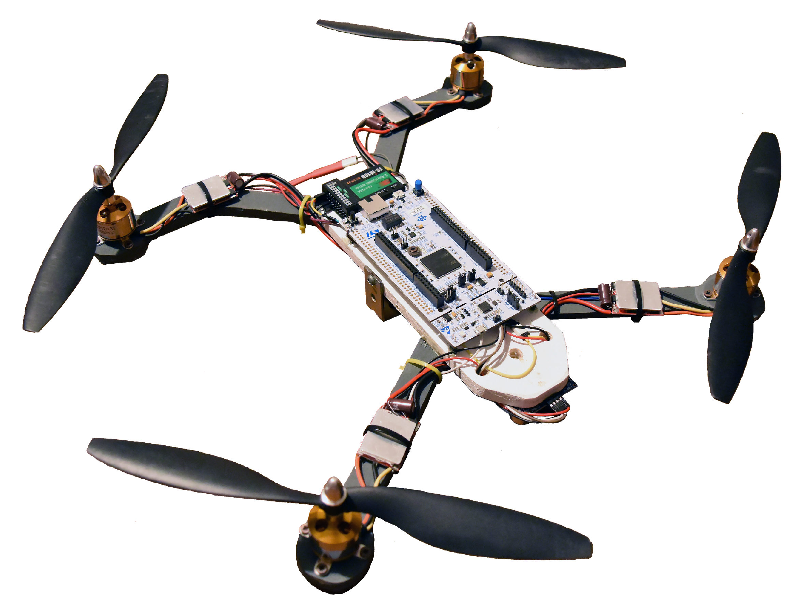
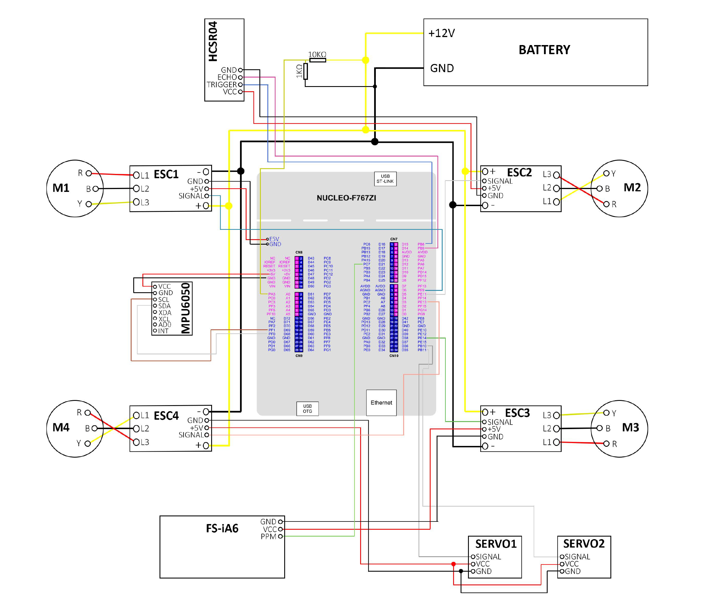
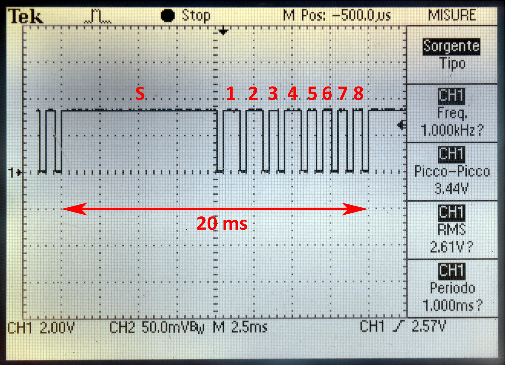
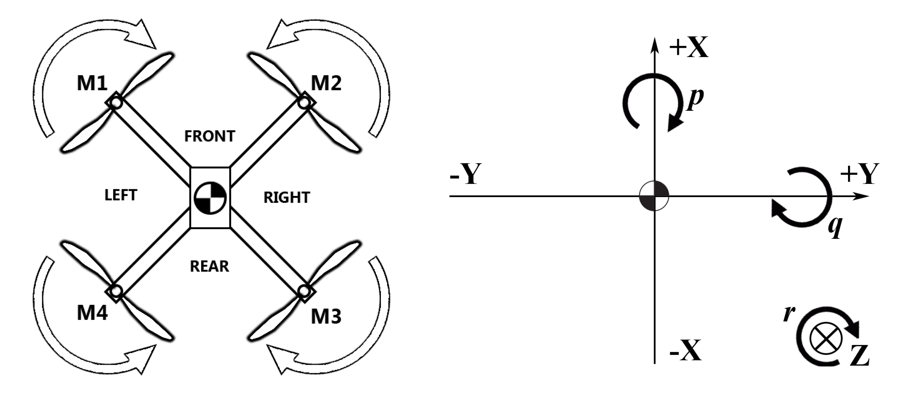
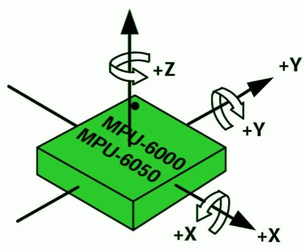
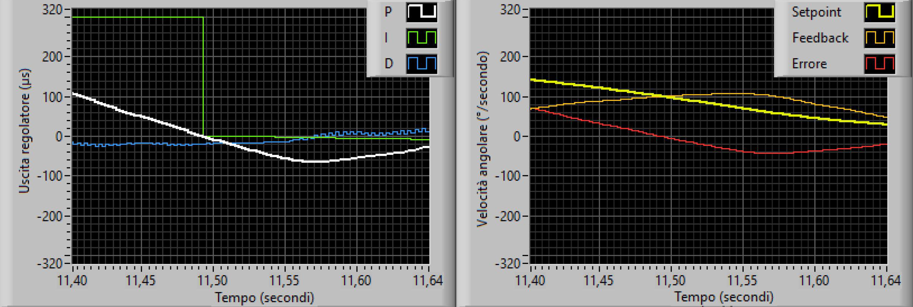
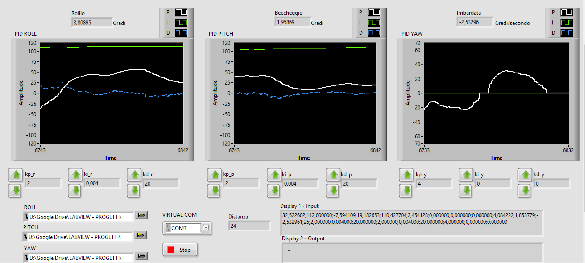
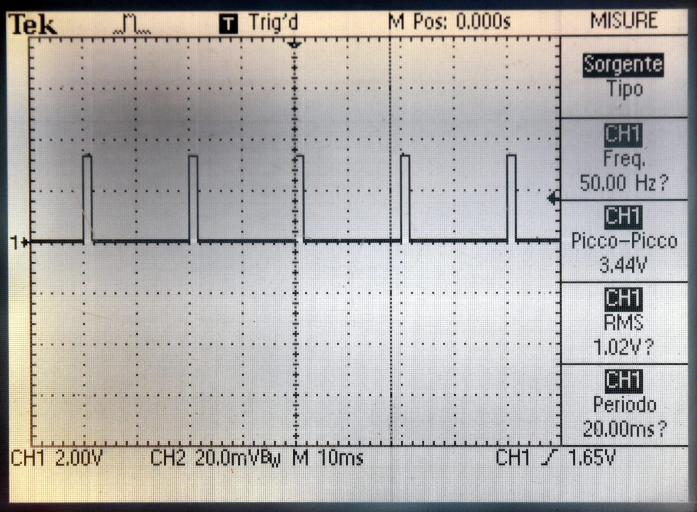
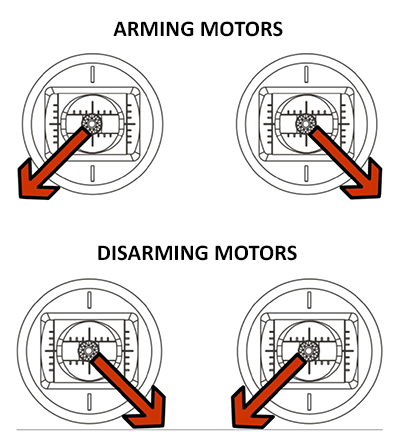

# QUADCOPTER FIRMWARE

This firmware is part of the project for my degree thesis: **Design and Testing of a 
Control System for a Quadcopter**.



## Requirements and build

- NUCLEO-F767ZI target.
- Legacy Mbed CLI (`mbed`) and a compatible `GCC_ARM` toolchain.
- The Mbed OS revision referenced by the `mbed-os.lib`:
  `bf6f2c3c6434a6de9eb9511feffa5948b3d1f20f`.

Mbed OS, the ARM compiler, and compiled firmware are not included. The code use 
the Mbed API family: `Serial`, `Timer::read()`, `Timer::read_us()`,
`wait()`, `wait_ms()`, and `wait_us()`. This is not an Mbed OS 6 API migration.
Restore the pinned dependency instead of replacing it with an arbitrary SDK.

Run these commands from the extracted `nucleo-f767zi-quadcopter` directory, using the environment
that supports the project's Mbed revision:

```sh
mbed deploy
mbed compile -m NUCLEO_F767ZI -t GCC_ARM --profile debug -c
```

For a clean release build:

```sh
mbed compile -m NUCLEO_F767ZI -t GCC_ARM --profile release -c
```

If the pinned `mbed-os` directory is already available locally, place it beside
`main.cpp` and skip `mbed deploy`. Keep that SDK's own Python/build dependencies
and ARM compiler configuration. The application requires C++11 and introduces no 
additional external libraries. VS Code build tasks are provided under `.vscode/`.


## Select the sensor fusion backend

Edit **`inc/fusion_selection.h`** and change this one default definition:

```cpp
#define SENSOR_FUSION_MODE FUSION_BASIC
```

---

<blockquote>
 ⚠️ <strong> WARNING: FUSION_DMP </strong> ⚠️   
 <br> The DMP's +/-2 g input can clip during strong acceleration or vibration. 
 Additionally, the ODR is only 200 Hz compared to the 1000 Hz of the other two modes. 
 Therefore, this mode has been implemented but not validated; it is completely 
experimental and may compromise PID operation in some motor and chassis combinations. </br>
</blockquote>

---

Choose exactly one value:

| Definition | Implementation | Processing location |
| --- | --- | --- |
| `FUSION_BASIC` | Gyro integration and accelerometer complementary correction. | STM32 |
| `FUSION_MADGWICK` | Six-axis Madgwick quaternion filter. | STM32 |
| `FUSION_DMP` | MotionApps 6.12 quaternion output from the MPU6050 DMP. | MPU6050, with FIFO transport/conversion on STM32 |

The header contains an `#ifndef` so a **project-wide** compiler definition can
also override the default. Do not define the mode only inside `main.cpp` or one
source file: every translation unit must see the same selection. Unsupported
values and misspelled mode names generate a preprocessor error. Perform a clean
build after changing modes. The serial console prints the selected backend.
There is no automatic switch to another algorithm after an initialization error.

All three backends explicitly configure the MPU6050 for continuous full-function
operation: every accelerometer/gyro axis and the temperature sensor are enabled,
sleep/cycle modes are off, and the X-gyro PLL is selected. Basic and Madgwick use
1 kHz raw sampling; DMP use the 200 Hz sensor input required by its existing
MotionApps image.

The DMP implementation includes its 3062-byte firmware image and a native Mbed
transport. The image is only compiled into `FUSION_DMP`. See `THIRD_PARTY_NOTICES.md` 
for the pinned upstream source, imagechecksum, and license.


### Operating profiles

| Setting | Basic | Madgwick | DMP MotionApps 6.12 |
| --- | --- | --- | --- |
| Operating mode | Continuous full-function | Continuous full-function | Continuous full-function |
| Accelerometer / gyro / temperature | All enabled | All enabled | All enabled |
| Clock | X-gyro PLL | X-gyro PLL | X-gyro PLL |
| `PWR_MGMT_1` (0x6B) | 0x01 | 0x01 | 0x01 |
| `PWR_MGMT_2` (0x6C) | 0x00 | 0x00 | 0x00 |
| `CONFIG` (0x1A) | 0x01 | 0x01 | 0x01 |
| Gyro DLPF bandwidth / delay | 188 Hz / 1.9 ms | 188 Hz / 1.9 ms | 188 Hz / 1.9 ms |
| Accel DLPF bandwidth / delay | 184 Hz / 2.0 ms | 184 Hz / 2.0 ms | 184 Hz / 2.0 ms |
| `SMPLRT_DIV` (0x19) | 0x00 | 0x00 | 0x04 |
| Sensor-register sampling rate | 1000 Hz | 1000 Hz | 200 Hz |
| `GYRO_CONFIG` (0x1B) | 0x18 | 0x18 | 0x18 |
| Gyro range | +/-2000 degrees/s | +/-2000 degrees/s | +/-2000 degrees/s |
| `ACCEL_CONFIG` (0x1C) | 0x10 | 0x10 | 0x00 |
| Accel range | +/-8 g | +/-8 g | +/-2 g |
| Acquisition for raw PID feedback | One 14-byte burst | One 14-byte burst | One 14-byte burst |
| DMP / FIFO | Off after calibration | Off after calibration | On for quaternion packets |
| I2C bus | 400 kHz | 400 kHz | 400 kHz |

For `DLPF_CFG=1`, the gyro output rate used in the sample-divider formula is
1000 Hz: `sample_rate = 1000 / (1 + SMPLRT_DIV)`. The 1 kHz profile is the maximum
register sample rate with this filter configuration and matches the
accelerometer's maximum underlying sample rate. An 8 kHz unfiltered gyro setup
would need a different acquisition/filtering design and would not provide
8 kHz accelerometer measurements.

188 Hz is a performance-oriented starting point with lower gyro filter delay
than the previous 42 Hz raw profile (1.9 ms versus 4.8 ms). Its useful bandwidth
and the necessary vibration filtering depend on the actual airframe. Measure
noise, clipping, and timing on the target before choosing further filter changes.
Full-function mode and DLPF settings are separate controls.

Wider ranges provide more maneuver/vibration headroom with coarser quantization.
Basic/Madgwick use +/-8 g and +/-2000 degrees/s as flight-oriented defaults. DMP
keeps +/-2 g and +/-2000 degrees/s to match the included opaque firmware image.

**The DMP's +/-2 g input can clip during strong acceleration or vibration; changing
that scale requires a compatible, validated DMP firmware configuration.**

**200 Hz in the table is the sensor-register/input rate, not a measured guarantee
of 200 quaternion packets per second.** FIFO packet cadence is determined by the
image, including its embedded divider.


## Project layout and responsibilities

All classes and application data types are in the `quadcopter` namespace.
Configuration and data-only headers are kept separate from hardware drivers.

| Header | Source | Responsibility |
| --- | --- | --- |
| `inc/flight_app.h` | `src/flight_app.cpp` | Own components, perform startup, and coordinate the control loop. |
| `inc/board_config.h` | `src/board_config.cpp` | Board pin assignments. |
| `inc/flight_config.h` | `src/flight_config.cpp` | Radio, PID, IMU, motor, battery, servo, and timing defaults. |
| `inc/flight_types.h` | Data declarations only | Samples, attitude, receiver frames/commands, control outputs, and motor pulses. |
| `inc/rc.h` | `src/rc.cpp` | Interrupt-based receiver decoding, snapshots, and stick conversion. |
| `inc/mpu6050.h` | `src/mpu6050.cpp` | MPU6050 register access, setup, sensor self-test, FIFO bias calibration, and raw reads. |
| `inc/mpu6050_registers.h` | Constants only | Namespaced MPU6050 register addresses. |
| `inc/imu.h` | `src/imu.cpp` | Calibration, body-frame software gyro offsets, unit conversion, and reporting. |
| `inc/imu_mounting.h` | Configuration only | One mounting rotation shared by acceleration, gyro rates/biases, and DMP orientation. |
| `inc/fusion_selection.h` | Preprocessor configuration only | Choose the single active fusion backend. |
| `inc/attitude_estimator.h` | `src/attitude_estimator.cpp` | Selected backend facade, common PID rate filtering, health status, and yaw-rate deadband. |
| `inc/basic_fusion.h` | `src/basic_fusion.cpp` | Complementary fusion equations. |
| `inc/madgwick_fusion.h` | `src/madgwick_fusion.cpp` | FRD Madgwick initialization, units, specific-force adaptation, and flight-angle output. |
| `inc/dmp_fusion.h` | `src/dmp_fusion.cpp` | DMP lifecycle, startup heading reference, and flight-angle output. |
| `inc/mpu6050_dmp.h` | `src/mpu6050_dmp.cpp` | Verified firmware upload, hardware setup, bounded FIFO reads, overflow handling, and data age. |
| `inc/mpu6050_dmp_firmware.h` | `src/mpu6050_dmp_firmware.cpp` | Pinned MotionApps 6.12 firmware image, enabled only for DMP builds. |
| `inc/orientation_math.h` | `src/orientation_math.cpp` | Quaternion normalization, gravity initialization, and shared flight-axis conversion. |
| `inc/pid.h` | `src/pid.cpp` | Rate PID with integral limits, conditional anti-windup, and integral reset on an error-sign change. |
| `inc/flight_control.h` | `src/flight_control.cpp` | Cascaded pitch/roll control and proportional yaw-rate control. |
| `inc/arming_control.h` | `src/arming_control.cpp` | Stick gestures and auxiliary-channel output enable. |
| `inc/motor_mixer.h` | `src/motor_mixer.cpp` | Four-motor mixing and pulse limits, independently of PWM hardware. |
| `inc/motor_controller.h` | `src/motor_controller.cpp` | ESC initialization, throttle cap, arming coordination, and PWM output. |
| `inc/range_finder.h` | `src/range_finder.cpp` | Paced HC-SR04 measurements, echo validity, freshness, and ground-distance gate. |
| `inc/battery_monitor.h` | `src/battery_monitor.cpp` | PA3 ADC sampling, divider conversion, and low-battery status. |
| `inc/status_indicators.h` | `src/status_indicators.cpp` | Independent, time-based armed and low-battery LED blinking. |
| `inc/servo_selection.h` | Preprocessor configuration only | Opt in to the two SG90 PWM outputs. |
| `inc/servo_controller.h` | `src/servo_controller.cpp` | Two-channel servo angle/pulse commands, enable/disable, and optional AUX control. |
| `inc/madgwick_filter.h` | `src/madgwick_filter.cpp` | Six-axis quaternion filter used by the Madgwick backend. |

`FlightApp` owns the hardware objects. `Mpu6050` receives the application's single
I2C bus by reference, and `Imu` receives the sensor by reference. Interrupt
callbacks are bound to their owning instances. Hardware owners cannot be copied.
Mutable control state is private to its instance; headers do not define mutable
globals or ordinary function bodies. The application uses fixed-size storage and
does not explicitly allocate memory with `new` or `delete`.

The PID, flight-control, attitude-estimation, arming, and mixing modules do not
depend on Mbed hardware classes. The basic and Madgwick backends and quaternion
math are also independent of Mbed. The DMP backend depends on the MPU6050
transport and a timer. Configuration is copied at construction, so modify defaults
before constructing the application.

## Wiring



| Function | Pin or value |
| --- | --- |
| Receiver input | `PC_7` |
| MPU6050 SDA / SCL | `PF_0` / `PF_1` |
| MPU6050 I2C address | 7-bit `0x68`; Mbed address argument `0xD0` |
| I2C frequency setting | 400,000 Hz |
| HC-SR04 trigger / echo | `PB_8` / `PB_9` |
| Motor 1, front left | `PE_9` |
| Motor 2, front right | `PE_11` |
| Motor 3, rear right | `PE_14` |
| Motor 4, rear left | `PE_13` |
| Console TX / RX | `USBTX` / `USBRX`, 921,600 baud |
| Battery ADC input | `PA_3`, midpoint of the 10 kOhm / 1 kOhm divider |
| Optional SG90 servo 1 | `PB_10`, TIM2 channel 3 |
| Optional SG90 servo 2 | `PB_11`, TIM2 channel 4 |
| Green LED | `LED1` / `PB_0`: 2 Hz while armed, off while disarmed |
| Blue LED | `LED2` / `PB_7`: 0.5 Hz below 11 V, off at or above 11 V after startup |
| Red LED | `LED3`, toggled once per control iteration |

Edit `src/board_config.cpp` to change pin assignments. The motor-order labels follow `assets/diagram-FRD.png`: M1 front left, M2 front
right, M3 rear right, M4 rear left. The mixer assumes M1/M3 spin clockwise and
M2/M4 counterclockwise when viewed from above, as drawn. Confirm those directions
against the actual motors before testing yaw corrections.


## Receiver decoding and commands

`RcReceiver` measures the rising-to-falling pulse duration.



| Raw buffer slot | Meaning |
| --- | --- |
| 0 (S) | Synchronization |
| 1 | Roll |
| 2 | Pitch |
| 3 | Throttle |
| 4 | Yaw |
| 5, 6, 8 | Auxiliary channels |
| 7 | Motor inhibit / output-enable switch |

Synchronization requires a pulse strictly greater than 3400 us and strictly
less than 11000 us. After synchronization, the nine-slot buffer wraps as in 
the code. If any channel in slots 1 through 8 exceeds 1650 us, the buffer
is cleared and synchronization is lost.

Roll, pitch, yaw, and throttle commands add 400 us to their raw values. Only
roll, pitch, and yaw are then clamped to 1000..2000 us. Arming gestures and the
auxiliary switch use **raw values without the 400 us offset**.

The main loop takes a short interrupt-protected snapshot of the shared buffer.
This prevents an ISR update during the copy and gives all consumers the same
values for an iteration. It does not wait for or introduce complete-frame
publication. There is no new receiver-loss timeout.


## Startup and control loop

Startup follows this order:

1. Enable receiver edge interrupts and configure I2C and the console.
2. Wait 500 ms, then check the MPU6050 identity and run its hardware self-test.
3. Under the self-test pass criterion, reset the sensor, perform FIFO
   bias calibration, and configure/verify continuous full-function raw sampling
   at 1 kHz with a 188 Hz gyro DLPF and +/-8 g / +/-2000 degrees/s ranges.
4. If the one-time data-ready check succeeds, average 20 gyro samples with a
   1 ms delay per sample and acquire the initial acceleration/rate sample.
5. Initialize the selected fusion backend. Basic computes the initial FRD
   tilt; Madgwick seeds its quaternion from acceleration; DMP uploads/verifies its
   firmware, restores the calibrated gyro hardware offsets, and waits for a valid
   quaternion packet.
6. If backend initialization succeeds, drive all ESCs at 2000 us for 3000 ms,
   then 1000 us for 1000 ms. Otherwise skip that sequence and keep motors disarmed
   at their configured minimum pulse.
7. Start the cycle timer and wait 1000 ms. For DMP, clear packets collected during
   the blocking startup, wait for a fresh packet, and establish the startup yaw
   reference before entering the stabilization loop.

All backends require successful backend initialization before motor control.
The checked MPU6050 power, timing, and range configuration must also succeed;
an I2C failure or a configuration readback mismatch inhibits startup motor control.
Basic and Madgwick reject a zero or nonfinite initial acceleration sample.
The hardware calibration criterion and runtime raw-read I2C error handling are
otherwise retained; these changes do not redesign the hardware self-test.
A failed backend initialization keeps outputs inhibited until restart; there is
no silent fallback to the basic algorithm.

Each iteration reads acceleration and angular velocity in one coherent 14-byte
I2C burst, updates the attitude
estimate, services the paced ultrasonic measurements, snapshots the receiver,
updates the optional servos, computes control outputs when fusion is available,
updates arming and motor outputs with the ground-distance gate, services battery
sampling and the LED indicators, toggles the red LED, and records the elapsed
cycle time. Battery sampling runs at 10 Hz. LED scheduling never sleeps or waits.

The first attitude update uses 0.0025 s. Later updates use the duration measured
at the end of the previous iteration, including two timer reads.
The loop is free-running; selecting a backend does not add a fixed-rate scheduler.
The configured sensor sample rate is independent of the control-loop frequency.
DMP packet delivery and the STM32 control loop are separate: raw gyro feedback
still updates in the control loop, while orientation changes when a complete DMP
packet arrives. Extra FIFO I2C work changes loop cost. Since the PID integral/
derivative use per-iteration gains, identical timing or flight response
across modes is not implied by using the same gains.


### IMU and attitude estimation

- Basic/Madgwick use continuous full-function operation at 1 kHz, +/-8 g and
  +/-2000 degrees/s. The wider ranges provide headroom against clipping during
  maneuvers and vibration, with coarser quantization than the previous ranges.
- DMP uses continuous full-function operation with its existing MotionApps 6.12
  sensor input at 200 Hz, +/-2 g and +/-2000 degrees/s. Its packet cadence is
  determined by the firmware image and must be measured on hardware.
- All modes use `CONFIG=0x01`: 188 Hz gyro bandwidth / 1.9 ms delay and
  184 Hz accelerometer bandwidth / 2.0 ms delay. Low-pass filtering remains
  enabled to limit high-frequency noise; this is independent of low-power mode.
- FIFO bias calibration temporarily uses +/-2 g and +/-250 degrees/s at 1 kHz
  for fine bias measurement, keeping the gyro PLL enabled. The operating
  configuration is applied afterward and its power/timing/ranges are read back.
- Raw sample conversion and software gyro bias calibration always use the
  driver's configured range resolutions. `ImuConfig` no longer duplicates
  hardware scale factors. Software gyro bias remains in degrees/s across the
  range change during DMP initialization.
- All application samples use body FRD: X forward, Y right, Z down.
  Gyro X is roll rate p, Y is pitch rate q, Z is yaw rate r. The physical
  mounting rotation is configured once in `inc/imu_mounting.h`.
- Each filtered rate uses 0.7 of its previous value and 0.3 of the new rate.
- Basic pitch and roll accelerometer correction factors both 0.001.
- The conversion factor from accelerometer radians to degrees is 57.296.
- Basic yaw uses gyro integration and a full 0..360 degree wrap.
  Madgwick and DMP derive yaw from their quaternions, subtract a startup reference,
  and wrap it into 0..360 degrees. None of these six-axis modes provides an
  absolute magnetic heading reference.
- The yaw-rate deadband is applied to the stored filtered state before control
  evaluation, preserving its effect on subsequent filter iterations.
- FIFO calibration writes gyro hardware offsets. Accelerometer hardware-offset
  writes remain disabled, and calculated accelerometer biases are reported but
  not subtracted from active samples.



`Imu::calibrationStatus()` exposes identity, sensor self-test results, FIFO
calibration/configuration status, hardware/software gyro offsets, and accelerometer biases.
The sensor's hardware self-test is part of startup firmware, not a unit test.


### Body FRD axes, mounting, and quaternion conventions

The MPU6050 mounting is: **native +X points FRONT, +Y LEFT,
+Z UP** (FLU). The craft uses **+X FRONT, +Y RIGHT, +Z DOWN** (FRD). The
conversion is the same proper 180-degree rotation about X for both sensors:

| Quantity | Body FRD component | Native MPU6050 source |
| --- | --- | --- |
| Roll rate p | X, forward axis | +gyro X |
| Pitch rate q | Y, right axis | -gyro Y |
| Yaw rate r | Z, down axis | -gyro Z |
| Specific force X | Forward | +accel X |
| Specific force Y | Right | -accel Y |
| Specific force Z | Down | -accel Z |



`inc/imu_mounting.h` defines the mounting quaternion `{0, 1, 0, 0}` in
`{w, x, y, z}` order. Acceleration, software gyro biases, raw gyro rate feedback
and DMP orientation all use it. Basic and Madgwick receive samples already
converted to FRD. Hardware gyro offsets remain in native register axes, as
required by the MPU6050; they are not remapped before writing the registers.

Only change this mounting quaternion if the sensor is physically remounted:

| Native sensor axes relative to the craft | `sensor_to_body` | Body vector |
| --- | --- | --- |
| X front, Y left, Z up | `{0, 1, 0, 0}` | `{sensor.x, -sensor.y, -sensor.z}` |
| X rear, Y right, Z up | `{0, 0, 1, 0}` | `{-sensor.x, sensor.y, -sensor.z}` |
| X front, Y right, Z down | `{1, 0, 0, 0}` | `{sensor.x, sensor.y, sensor.z}` |

The accelerometer reports **specific force**. A stationary level craft
therefore reads approximately `(0, 0, -1)` g in body FRD. Static tilt uses:

```text
roll  = atan2(-accel_body.y, -accel_body.z)
pitch = atan2( accel_body.x, sqrt(accel_body.y^2 + accel_body.z^2))
```

Roll rotates about X even though its gravity observation uses Y/Z acceleration.
Pitch rotates about Y and changes the X gravity component. The different
accelerometer formulas follow geometry; the two PID laws remain identical.
Positive roll means right side down, positive pitch means nose up, and positive
yaw is clockwise viewed from above, all following the right-hand rule.

Basic integrates gyro X into roll and Y into pitch and corrects both with the
measured tilt. This retains the small-angle integration approximation: body p/q
are not exact Euler-angle derivatives during large coupled rotations. Basic
skips correction when acceleration has zero magnitude, rather than correcting
with a stale observation. Nonfinite runtime inputs make it unavailable.

Madgwick runs directly in FRD. It receives body rates in radians/s and **negative
body specific force** as its gravity-down observation. The initial quaternion
uses the same accelerometer tilt convention. Zero acceleration skips the gravity
correction but permits gyro integration.

DMP packets remain native sensor-to-world-up quaternions. The adapter converts
them into body-to-world-NED attitude using the mounting rotation and a fixed
180-degree X rotation of the reference frame. That reference rotation changes
world up to world down while preserving reference X and is separate from
physical mounting. With the FLU mounting, the full quaternion
conversion is `q_FRD = q_X180 * q_DMP * conjugate(q_X180)`, i.e.
`(w, x, -y, -z)` after normalization. The adapter converts quaternion frames
before extracting angles; there is no second sign flip of the FRD gyro. Madgwick and DMP
then share standard ZYX Euler conversion: roll about X, pitch about Y, yaw about Z.
Roll spans +/-180 degrees, pitch +/-90 degrees, with the usual Euler singularity
at +/-90-degree pitch. Both quaternion backends zero yaw at startup.


### DMP initialization, transport, and availability

`Mpu6050Dmp` ports the MotionApps 6.12 initialization/image from i2cdevlib revision
`8eda2ce663c05c7b490778fadf1a1f5848e1b268`. The image is included in flash as const
bytes and uploaded at each device initialization. Transfers use 16-byte chunks,
respect 256-byte memory-bank boundaries, and read back every chunk for comparison.
Checked I2C operations use the address of the existing `Mpu6050` instance. The
original calibrated gyro hardware offsets are saved before the DMP reset and
restored before DMP operation.

The firmware uses **28-byte packets**. The first 16 bytes contain four
big-endian Q30 quaternion components; the remaining packet bytes are consumed
but not used for PID rate feedback. The code does not mix the 28-byte v6.12
format with the 42-byte MotionApps v2.0 format. The gyro PID feedback goes
through the calibrated raw-register acquisition and 0.7/0.3 filter.

DMP FIFO availability is polled over the existing I2C connection; no extra MPU6050
interrupt wire or board pin is required. A read processes only complete packets
present in one FIFO-count snapshot and keeps the newest of those packets. Work
is bounded by the 1024-byte FIFO capacity. An incomplete packet is left for a
later iteration. The image determines DMP packet cadence; no unsupported
runtime firmware-rate patch is applied. Its actual cadence and timing remain to
be measured on the target.

An overflow resets FIFO alignment. A failed FIFO read also attempts a reset,
since a partial I2C transfer may have consumed bytes. Quaternions are checked for
finite/plausible norm and normalized before conversion. These checks do not add
a packet checksum; they cannot detect every possible corrupted quaternion.

Default backend settings are in `src/flight_config.cpp`:

| Setting | Default | Meaning |
| --- | --- | --- |
| `fusion.madgwick_gyro_error_dps` | 60 degrees/s | Madgwick beta input: `sqrt(3/4) * error_in_radians_per_second`. |
| `fusion.dmp_startup_timeout_ms` | 1000 ms | Deadline for the first valid packet during startup synchronization, excluding upload/reset delays. |
| `fusion.dmp_stale_timeout_ms` | 100 ms | Maximum allowed age since the last valid DMP packet. |

When there is briefly no new DMP packet, the previous valid orientation is held
within the age limit. DMP I2C errors, FIFO overflow, invalid quaternion data, or
expired data make the backend unavailable. Madgwick initialization/numerical
failures also make its backend unavailable. `FlightApp` then sends minimum motor
pulses, clears the armed state, and resets PID state. A fresh valid runtime
estimate can restore availability; the normal arming gesture is required again.
Initialization failures do not automatically retry the ESC startup.

While DMP is active, its backend owns sensor ranges, FIFO, DLPF,
sample-divider, and memory configuration; reinitializing or putting the MPU6050
into low-power raw mode would overwrite that setup.


### PID coefficients and identical roll/pitch logic

There is one shared `control.roll_pitch_rate` configuration. **Kp, Ki and Kd
remain three distinct values**: both axes use the same Kp, the same Ki and the
same Kd. The former roll settings are the common defaults. Each `PidController`
keeps its own integral and previous-error state.

| Parameter | Roll | Pitch | Yaw |
| --- | --- | --- | --- |
| Outer angle gain | 5.5 | 5.5 | Not used |
| Stick divisor | 16.6 | 16.6 | 3.0 |
| Rate Kp | 1.5 | 1.5 | 4.0 |
| Rate Ki | 0.004 | 0.004 | Not used |
| Rate Kd | 18.0 | 18.0 | Not used |
| Integral limit | +/-80 | +/-80 | Not used |
| Output limit | +/-200 | +/-200 | +/-50 |
| Outer-loop rate limit | +/-180 degrees/s | +/-180 degrees/s | Not used |




`FlightControl::updateAxis()` implements the same cascade for both axes:

1. Apply the common 1492..1508 us stick deadband and stick divisor.
2. Subtract the corresponding measured angle.
3. Apply the common angle gain and clamp the rate setpoint.
4. Subtract body rate X for roll or Y for pitch.
5. Evaluate the rate PID with the shared coefficients and limits.

The outer **angle loop is proportional** and the inner **rate loop is full
P/I/D**, for both axes. Yaw use proportional rate control and its strict
-1..1 degrees/s filtered-rate deadband.

```text
P = Kp * error
I_candidate = clamp(I + Ki * error, -integral_limit, +integral_limit)
D = Kd * (error - previous_error)
output = clamp(P + I_accepted + D, -output_limit, +output_limit)
```

Zero error or a sign change clears the integral. The first
iteration after a sign change does not add an integral increment. In addition
to the integral bound, conditional anti-windup rejects an increment if it pushes
P+I+D farther beyond the positive or negative PID output limit. Increments
opposing that saturation remain allowed. This checks the **PID output limit**;
it does not receive feedback from individual motor clipping or motor inhibit.
Ordinary stick arming/disarming still preserves PID history. Fusion faults
disarm and reset it.

I and D use **per-iteration gains**, without multiplying or dividing by cycle
duration. The loop is free-running, and these gains have not been tuned on the
airframe. Identical input histories now produce identical numerical roll/pitch
outputs; equal physical motion is still affected by the airframe mechanics.

Edit `src/flight_config.cpp` before constructing the application. External code
using separate `control.roll_rate` / `control.pitch_rate` settings must migrate
to `control.roll_pitch_rate`. The angle gain, stick divisor and rate limit also
now each have one shared `roll_pitch_*` setting.

### Motors and arming

Throttle is capped at 1700 us before mixing. Each mixed result is independently
limited to 1000..2000 us. PWM uses an explicit 20000 us period.



| Motor | Mixing equation |
| --- | --- |
| Front left, M1 | `throttle + pitch + roll - yaw` |
| Front right, M2 | `throttle + pitch - roll + yaw` |
| Rear right, M3 | `throttle - pitch - roll - yaw` |
| Rear left, M4 | `throttle - pitch + roll + yaw` |

Positive pitch torque increases the front motors to lift the nose. Positive
roll torque increases the left motors to lower the right side. Positive yaw
torque increases CCW M2/M4, assuming the directions in the supplied diagram.
These pitch and yaw signs match FRD convention.

Arming requires raw yaw, throttle, and pitch below 700 us and raw roll above
1500 us. Disarming requires converted throttle below 1050 us, raw yaw above
1500 us, and raw throttle, pitch, and roll below 700 us. **Both stick gestures
are accepted only with a valid, fresh range-finder measurement strictly below
40 cm.** At 40 cm or above, before the first valid echo, after an echo timeout,
or with expired data, gestures leave the current armed state unchanged. Flying
above 40 cm does not automatically disarm an already armed craft. The limit is
`config.motors.gesture_max_distance_cm`.



The application starts disarmed. Mixed pulses are sent only while armed and raw channel 7 is below
1100 us; otherwise all four outputs receive 1000 us. The channel-7 switch
inhibits output without clearing the armed state. Explicit fault disarming
(`MotorController::disarm()` for unavailable sensor fusion) and the existing
channel-7 output inhibit remain effective at every height; only radio stick
state transitions are gated by distance.

The startup 2000 us sequence remains independent of the runtime stick arming
checks, but now requires successful fusion-backend initialization.


### Range finder and other driver functions

`RangeFinder` use the HC-SR04 driver's 10 us trigger and integer conversion
`distance_cm = pulse_us * 343 / 20000`. Echo interrupts complete measurements
asynchronously. Call `sample()` every control iteration: it starts a measurement
only when the 60 ms measurement interval has elapsed and returns the latest
completed distance without waiting for a new echo.

An echo must have a preceding rise in the current acquisition, a width of at
least 100 us, and completion within 30 ms of the trigger. Missing or late echoes
invalidate the reading. Echoes shorter than 100 us are rejected. Data expire
250 ms after the last valid completion, even if acquisition has stopped. Startup
zero is not a valid reading. All intervals use unsigned microsecond differences
so normal operation continues across the ticker's 32-bit rollover.

`hasValidReading()` checks validity and age. `isBelowCm(limit)` checks validity,
age, and the strict distance limit using the unrounded pulse width in one
interrupt-protected snapshot. `distanceCm()` and `pulseWidthUs()` retain the last
completed valid values for inspection and may contain old values; use the
validity API before acting on them. The ground-distance gate uses `isBelowCm()`,
not the initial zero or a rounded display value. No altitude-hold controller is
added.

The low-power accelerometer mode, raw temperature read, resolution calculations,
and low-level register helpers remain available on `Mpu6050`. `MadgwickFilter`
is used by `MadgwickFusion` when selected and can also be used independently;
its angular-rate inputs are radians/s. DMP firmware and polling are separate
modules rather than methods embedded in the raw MPU6050 driver.

### Battery and LED indication

Wire the battery positive terminal through **10 kOhm to PA3**, and connect
**1 kOhm from PA3 to ground**. Battery negative, divider ground, and board ground
must be common. The ADC uses PA3 as an analog input, not as a PWM output.

```text
Vpin = Vbat * 1000 / (10000 + 1000) = Vbat / 11
Vbat = AnalogIn.read() * adc_reference_voltage / divider_ratio
```

Defaults in `src/flight_config.cpp` are a 3.3 V ADC reference, exact divider ratio
`1.0f / 11.0f`, a strict 11.0 V low threshold, and a 100000 us sample interval.
At 11 V the divider node is 1 V; at 12.6 V it is approximately 1.145 V. Adjust
`adc_reference_voltage` to the measured board reference and `divider_ratio` to
the actual resistor ratio if calibration is needed. `BatteryMonitor::voltage()`
exposes the latest voltage for application code or debugger inspection.

| Runtime condition | LED behavior |
| --- | --- |
| Armed | Green on 250 ms, off 250 ms: 2 Hz |
| Disarmed | Green off |
| Measured battery below 11 V | Blue on 1000 ms, off 1000 ms: 0.5 Hz |
| Measured battery at or above 11 V | Blue off |

Both indications run independently with a 50% duty cycle and begin with the LED
on when their condition becomes active. The blue LED is used as calibration-error 
use during blocking startup, then becomes dedicated to battery status. Runtime 
fusion errors remain visible in the serial console and still force disarming, 
without changing the battery blink pattern. A low battery only changes the blue 
indication; it does not stop or disarm the motors. The threshold has no added 
hysteresis or smoothing, so noise around 11 V may change its status.


### Optional SG90 servo control

Servo PWM is disabled in the application by default. Edit
`inc/servo_selection.h`:

```cpp
#define ENABLE_SG90_SERVOS 1
```

Alternatively define it for the entire build with `-DENABLE_SG90_SERVOS=1`.
Perform a clean build after changing this setting. With the setting at zero,
`FlightApp` does not instantiate the servo controller or configure PB10/PB11.

The controller uses PB10/TIM2_CH3 and PB11/TIM2_CH4, with a common 20000 us
period (50 Hz) and independent pulse widths. Motors are on TIM1, and the
pinned Mbed target reserves TIM5 for its microsecond ticker. PA3 is used only by
the ADC, so its alternative TIM2_CH4 pin function is not enabled.

When enabled, initialization centers and enables both servo outputs after the
blocking sensor/ESC startup. The default `config.servos.follow_receiver = true`
maps raw receiver AUX1 (slot 5) to PB10 and AUX2 (slot 6) to PB11. It applies the
existing radio command offset and axis limits before scaling to servo pulses:

| Raw AUX pulse | Converted command | Servo pulse | Logical angle |
| --- | --- | --- | --- |
| 600 us | 1000 us | 1000 us | 0 degrees |
| 1100 us | 1500 us | 1500 us | 90 degrees |
| 1600 us | 2000 us | 2000 us | 180 degrees |

Commands outside the configured pulse limits are clamped. A zero or invalid
AUX pulse centers its channel. Servo commands are independent of motor arming.

The default pulse limits are 1000..2000 us with 1500 us neutral. They deliberately
form a conservative initial command range. Logical 0..180 degree commands are
linearly mapped to those limits; actual shaft angles and safe mechanical travel
must be calibrated for the specific SG90 and linkage before widening the range.

For application-driven positions, set `config.servos.follow_receiver` to false
before constructing `FlightApp`, then issue commands on its `servos_` member
inside the application, for example:

```cpp
#if ENABLE_SG90_SERVOS
servos_.setAngleDeg(ServoController::First, 45.0f);
servos_.setPulseWidthUs(ServoController::Second, 1600);
#endif
```

| Method | Behavior |
| --- | --- |
| `setAngleDeg(channel, angle)` | Clamp finite logical angles to 0..180 degrees and map to configured pulses. |
| `setPulseWidthUs(channel, pulse)` | Clamp and store a pulse; apply it if outputs are enabled. |
| `pulseWidthUs(channel)` | Return the stored command, including while disabled. |
| `center()` | Store/apply neutral on both channels. |
| `disable()` | Set both output pulse widths to zero; servo supply power is not switched. |
| `enable()` | Resume both stored commands. |
| `enabled()` | Report whether PWM commands are being applied. |
| `updateFromReceiver(frame, radio)` | Update both commands from AUX1/AUX2. |

Power the servo motors from a suitable regulated external servo supply with
common ground to the Nucleo. TowerPro specifies 4.8 V for the analog SG90. PB10
and PB11 carry the control signals; the LiPo 3S pack must not be connected
directly to the servo supply or the ADC pin. The PA3 battery connection always
passes through the divider described above.


## References
- [Nucleo Manual](docs/dm00244518-stm32-nucleo144-boards-stmicroelectronics.pdf)
- [HCSR04 Specifications](docs/HCSR04.pdf)
- [MPU6050 Registers Map](docs/RM-MPU-6000A.pdf)
- [InvenSense MPU6050 product specification, sections 7.8 and 11.1](https://cdn.sparkfun.com/datasheets/Components/General%20IC/PS-MPU-6000A.pdf)
- [InvenSense MPU6050 register map](https://cdn.sparkfun.com/datasheets/Sensors/Accelerometers/RM-MPU-6000A.pdf)
- [Madgwick original algorithm resources](https://x-io.co.uk/open-source-imu-and-ahrs-algorithms/)


## Third-party notices

The range-finder implementation derives from the supplied HC-SR04 driver by
Prabhu Desai, copyright 2013. Its complete permission and warranty notice is
reported in both `inc/range_finder.h` and `src/range_finder.cpp`.

The DMP image and initialization port carry the additional upstream notice in
`THIRD_PARTY_NOTICES.md` and `src/mpu6050_dmp_firmware.cpp`.


## Disclaimer

THE SOFTWARE IS PROVIDED "AS IS", WITHOUT WARRANTY OF ANY KIND, EXPRESS OR IMPLIED. 
IN NO EVENT SHALL THE AUTHORS OR COPYRIGHT HOLDERS BE LIABLE FOR ANY CLAIM, DAMAGES 
OR OTHER LIABILITY, WHETHER IN AN ACTION OF CONTRACT, TORT OR OTHERWISE, ARISING FROM, 
OUT OF OR IN CONNECTION WITH THE SOFTWARE OR THE USE OR OTHER DEALINGS IN THE SOFTWARE.

**Safety Notice:** Testing a custom flight controller on STM32 hardware involves high 
physical risks. Always perform initial testing with propellers removed and use a tethered 
setup or safety cage when first testing flight dynamics.
